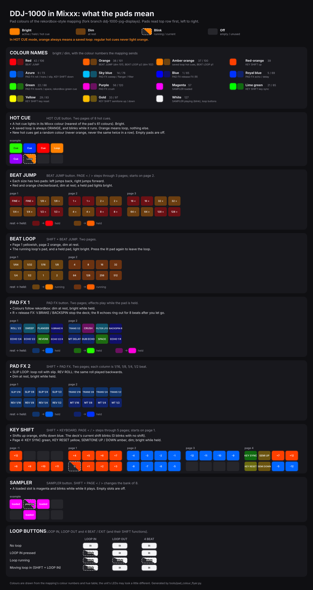

# What the pads mean

A one-page guide to the pad and loop-button lights of the rekordbox-style DDJ-1000 mapping (Mixxx fork, branch
`ddj-1000-jog-displays`): every pad mode and page, what each colour means, and how the lights change when a pad is
held or something is running.

## How to read it

- **Bright** = active, held, or a hot cue. **Dim** = at rest. **Blink** = running or current. **Off** = empty.
- On the unit, colour numbers 64-127 are the dim form of the colour 64 lower (confirmed on the unit); rekordbox
  lights idle pads dim and held pads bright, and the mapping does the same (see [`REKORDBOX_LEDS.md`](REKORDBOX_LEDS.md)).
- In HOT CUE mode orange always means a saved loop; regular hot cues never light orange.

## Keeping it up to date

The flyer is generated: `python tools/pad_colour_flyer.py` rewrites `docs/pad-colours.svg`. Its tables list the colour
numbers the mapping sends per mode, and it draws them with the mapping's own hue table, so the swatches are close to
the unit's LEDs but not a measurement of them. Change the tables when the mapping's colours change.
